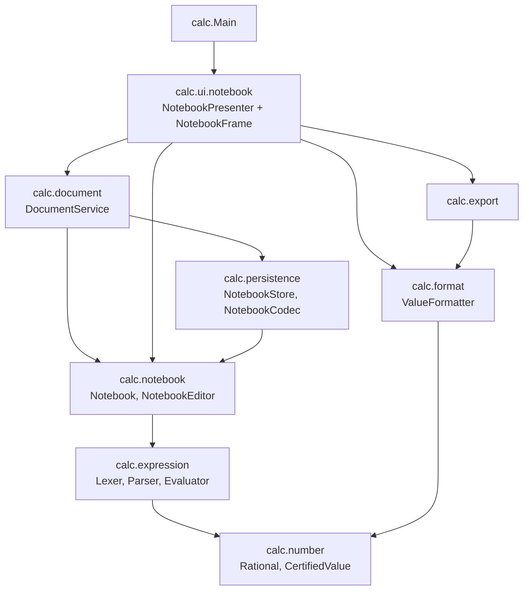

# Architecture

Calc est une application Swing organisée en couches. Chaque couche ne dépend que de celles qui sont en dessous, et deux
tests le vérifient (`NotebookDependenciesTest`, `ServicesDependenciesTest` : voir les garanties G25 de
[TESTS.md](TESTS.md)). Les sources sont dans `src/main/java/calc`.

## Les packages

| Package | Responsabilité | Ne dépend pas de |
|---|---|---|
| `calc.number` | Noyau numérique exact : `Rational` (fraction toujours réduite), `CertifiedValue` (intervalle `[bas, haut]` exact ou approché, avec garantie d'inclusion), `NumericLimits` (bornes), `NumericException` (code `NumericError`, aucun texte pour l'utilisateur) | tout le reste |
| `calc.format` | `ValueFormatter` : le seul endroit où une valeur devient du texte (modes Auto, Décimal, Fraction, Scientifique, texte canonique réutilisable) | l'interface, la persistance |
| `calc.expression` | Langage d'expressions : `Lexer`, `ExpressionParser` (descente récursive bornée), `Node` (arbre immuable), `Evaluator` (évaluation avec le noyau exact), `CanonicalPrinter`, `ReferenceRewriter` (renumérotation des `$n`), `ExpressionException` (code, position, message français) | l'interface, la persistance |
| `calc.engine` | Moteur « deux opérandes » hérité de l'ancien formulaire : lecture d'un littéral (`NumberLiterals`, partagée avec le langage), messages des refus du noyau (`NumericMessages`), bornes (`CalculationLimits`), écriture atomique de fichiers (`AtomicFileWriter`), types de l'ancien historique (`CalculationRecord`, `Operation`) | l'interface |
| `calc.notebook` | Modèle du carnet : `Notebook` (lignes immuables), `NotebookEditor` (commandes, annuler / rétablir), `NotebookEvaluator` (références, variables, propagation des erreurs) | l'interface, la persistance |
| `calc.persistence` | Fichiers : `NotebookStore` (carnet courant, migration, verrou), `NotebookCodec` (format v3), `JsonHistoryStore` et `HistoryCodec` (ancien historique v2), `LegacyTsvReader` (v1), `DataDirectory`, `StoreLock`, lecteur JSON strict | l'interface |
| `calc.document` | `DocumentService` : nouveau, ouvrir, enregistrer, enregistrer sous, indicateur « modifié », version future en lecture seule. Les chemins sont des paramètres, aucun dialogue | l'interface |
| `calc.export` | `NotebookExporter` : exports Markdown et CSV | l'interface |
| `calc.ui` | `DisplayModeStore` (mode d'affichage mémorisé), phrases d'exactitude | — |
| `calc.ui.widget` | Composants Swing réutilisables : sélecteur de mode, badge d'exactitude, palette et contrastes | la fenêtre |
| `calc.ui.notebook` | La fenêtre principale : `NotebookPresenter` (toute la logique d'interaction, testable sans Swing), `NotebookViewModel` (état immuable remis à la vue), `NotebookFrame` et `NotebookRowView` (Swing, rien d'autre que l'affichage), `NotebookDialogs` (interface des boîtes de dialogue, remplacée par un faux dans les tests) | — |
| `calc` | `Main` : branche le magasin du carnet, le mode d'affichage et la fenêtre | — |

## Flux d'une ligne

Ce qui se passe quand l'utilisateur valide `prix * 3` :

1. **Saisie** : `LineField` (Swing) transmet le texte au `NotebookPresenter`, qui est le seul à décider (valider, naviguer,
   annuler). La vue ne contient aucune règle.
2. **Analyse** : `NotebookEditor` applique la commande au `Notebook`, sur le fil de l'interface. Le calcul part alors sur un
   fil de fond (`NotebookRecalculation`, [ADR 0014](adr/0014-calcul-hors-interface.md)), dont les résultats reviennent ligne à
   ligne sous un numéro de génération. `Lexer` puis `ExpressionParser` produisent un
   arbre `Node` ou une `ExpressionException` positionnée. Les limites (1000 caractères, 100 niveaux, 500 éléments) sont
   contrôlées avant tout calcul.
3. **Évaluation exacte** : `NotebookEvaluator` évalue les lignes dans l'ordre ; `Evaluator` calcule avec `Rational` (exact)
   et `CertifiedValue` (intervalle certifié, seulement pour une racine non exacte). Les variables et les références
   (`ans`, `$n`) sont résolues contre les lignes du dessus ; une ligne qui dépend d'une ligne en erreur est en erreur.
4. **Formatage** : `ValueFormatter` transforme chaque valeur en texte selon le mode d'affichage. Changer de mode reformate
   sans rien recalculer.
5. **Affichage** : le présentateur remet un `NotebookViewModel` immuable à `NotebookFrame`, qui l'affiche (texte, badge
   « Exact » ou « ≈ Approché », message d'erreur et partie fautive soulignée).
6. **Persistance** : `DocumentService` écrit le carnet (`NotebookCodec`, écriture atomique) après chaque commande qui
   change quelque chose, si le document est le carnet sans titre. Le fichier ne contient que les textes des lignes et le
   mode d'affichage : **aucun résultat n'est enregistré**, les résultats sont recalculés à l'ouverture.

## Persistance et migrations

- Le carnet courant est `carnet-courant.calc.json` dans le dossier de données (voir le [guide](GUIDE-UTILISATEUR.md) et
  [FORMAT-FICHIER.md](FORMAT-FICHIER.md)). Un document enregistré par l'utilisateur est un fichier `.calc.json`
  quelconque.
- **Migration** au premier lancement (`NotebookStore`) : l'historique v1 (`history.tsv`) est lu par `LegacyTsvReader`, converti
  en historique v2 puis en carnet v3 (une ligne par calcul, via `HistoryBridge`). Chaque source est copiée en `.bak` avant
  d'être remplacée, sans jamais écraser une sauvegarde ; relancer la migration ne change rien (idempotence).
- **Version future** : un fichier écrit par une version plus récente de Calc est ouvert en lecture seule et jamais réécrit.
- **Une seule instance écrit** : `StoreLock` prend un verrou du système sur le dossier de données ; la seconde fenêtre
  charge le carnet mais n'écrit rien.
- **Fichier abîmé ou hostile** : refusé avec une cause (`NotebookFormatException`), copié en `.bak` quand c'est possible,
  jamais remplacé sans copie. Les tailles sont bornées (fichier de 16 Mio, 5000 lignes, 16 384 caractères par ligne).

## Principes

- **Exact d'abord** : les résultats sont des fractions exactes ; seule une racine non exacte est approchée, avec un
  intervalle qui contient certainement la vraie valeur ([ADR 0003](adr/0003-representation-numerique.md)).
- **Une seule règle de texte** : la valeur affichée n'est jamais celle qui est réutilisée ; la valeur réutilisée est le texte
  canonique, relu exactement ([ADR 0004](adr/0004-regles-affichage.md)).
- **La logique ne vit pas dans la vue** : le présentateur est testé sans fenêtre ; la fenêtre est testée à part (tests `ui`).
- **Tout est borné avant d'être calculé** : tailles, profondeur, nombre de lignes, taille des fichiers.
- **Jamais de perte silencieuse** : un échec d'écriture garde la modification en mémoire et le dit ; une ligne que le
  langage refuse reste dans le carnet.

## Décisions (ADR)

L'index est dans [adr/README.md](adr/README.md). Les plus utiles pour lire le code : 0003 (représentation numérique),
0004 (règles d'affichage), 0007 (grammaire), 0008 (sémantique du carnet), 0009 (format v3, documents, exports), 0010
(éditeur), 0011 (fichiers dans l'interface), 0012 (packaging et releases). Les mesures de fiabilité et leur stratégie sont
dans [TESTS.md](TESTS.md) ; l'intégration continue dans [CI.md](CI.md).
