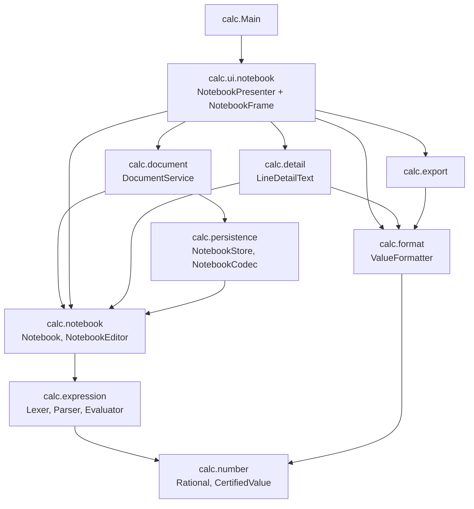

# Architecture

Calc est une application Swing organisée en couches. Chaque couche ne dépend que de celles qui sont en dessous, et deux
tests le vérifient (`NotebookDependenciesTest`, `ServicesDependenciesTest` : voir les garanties G25 de
[TESTS.md](TESTS.md)). Les sources sont dans `src/main/java/calc`.

## Les packages

| Package | Responsabilité | Ne dépend pas de |
|---|---|---|
| `calc.number` | Noyau numérique exact : `Rational` (fraction toujours réduite), `CertifiedValue` (intervalle `[bas, haut]` exact ou approché, avec garantie d'inclusion), `NumericLimits` (bornes), `NumericException` (code `NumericError`, aucun texte pour l'utilisateur) | tout le reste |
| `calc.format` | `ValueFormatter` : le seul endroit où une valeur devient du texte (modes Auto, Décimal, Fraction, Scientifique, texte canonique réutilisable, bornes garanties d'une valeur approchée arrondies vers l'extérieur) | l'interface, la persistance |
| `calc.expression` | Langage d'expressions : `Lexer`, `ExpressionParser` (descente récursive bornée), `Node` (arbre immuable), `Evaluator` (évaluation avec le noyau exact), `CanonicalPrinter`, `ReferenceRewriter` (renumérotation des `$n`), `ExpressionException` (code, position, message français) | l'interface, la persistance |
| `calc.engine` | Moteur « deux opérandes » hérité de l'ancien formulaire : lecture d'un littéral (`NumberLiterals`, partagée avec le langage), messages des refus du noyau (`NumericMessages`), bornes (`CalculationLimits`), écriture atomique de fichiers (`AtomicFileWriter`), types de l'ancien historique (`CalculationRecord`, `Operation`) | l'interface |
| `calc.notebook` | Modèle du carnet : `Notebook` (lignes immuables), `NotebookEditor` (commandes, annuler / rétablir), `NotebookEvaluator` (références, variables, propagation des erreurs, sources de chaque ligne), `EvaluatedNotebook.usedBy` (les lignes qui utilisent une ligne), `LineExpansion` (développement d'un niveau) | l'interface, la persistance, la mise en forme |
| `calc.detail` | `LineDetailText` : le détail d'une ligne en français (développement, résultat affiché, sources, lignes qui l'utilisent, bornes garanties), partagé par le bureau et le web | Swing, AWT, l'interface, la persistance, les documents |
| `calc.persistence` | Fichiers : `NotebookStore` (carnet courant, migration, verrou), `NotebookCodec` (format v3), `JsonHistoryStore` et `HistoryCodec` (ancien historique v2), `LegacyTsvReader` (v1), `DataDirectory`, `StoreLock`, lecteur JSON strict | l'interface |
| `calc.document` | `DocumentService` : nouveau, ouvrir, enregistrer, enregistrer sous, indicateur « modifié », version future en lecture seule. Les chemins sont des paramètres, aucun dialogue | l'interface |
| `calc.export` | `NotebookExporter` : exports Markdown et CSV | l'interface |
| `calc.ui` | `DisplayModeStore` et `ThemeStore` (mode d'affichage et thème choisi, `ThemeChoice`, mémorisés), phrases d'exactitude | — |
| `calc.ui.design` | Jetons de design (ADR 0016) : `DesignTokens` lit `tokens.properties`, la seule source des couleurs par rôle et par thème (`Theme` : clair, sombre), des polices, des tailles et des paires de contraste | tout le reste de l'application |
| `calc.ui.theme` | Apparence (ADR 0017) : `ThemeManager` installe les polices embarquées Inter et JetBrains Mono et applique `CalcLightLaf` ou `CalcDarkLaf`, thèmes FlatLaf lus dans les `.properties` générés des jetons ; `SystemThemeDetector` lit le thème du système (Windows seulement, `WindowsSystemThemeDetector`) | la fenêtre |
| `calc.ui.widget` | Composants Swing réutilisables : contrôle segmenté des modes, palette (thème actif lu dans l'apparence installée) et contrastes | la fenêtre |
| `calc.ui.notebook` | La fenêtre principale : `NotebookPresenter` (toute la logique d'interaction, testable sans Swing), `NotebookViewModel` (état immuable remis à la vue, détail de la ligne active compris), `NotebookPreview` (l'aperçu de la ligne en cours de frappe, sur son propre fil), `CommandPalette` (la palette de commandes comme modèle, sans Swing : entrées dérivées des menus, recherche sans casse ni accents), `NotebookExamples` (les trois carnets d'exemple du carnet vide, insérés par `NotebookPresenter.onInsertExample` en une commande annulable), `NotebookFrame`, `NotebookRowView`, `LineDetailView`, `ExamplesPanel` (les trois boutons d'exemple, un seul panneau sous les lignes), `SyntaxHelpDialog` (l'aide de syntaxe, fenêtre non modale à exemples insérables) et `CommandPaletteView` (Swing, rien d'autre que l'affichage ; la palette est une couche du `JLayeredPane`, jamais un dialogue), `NotebookDialogs` (interface des boîtes de dialogue, remplacée par un faux dans les tests) | — |
| `calc` | `Main` : installe le thème, branche le magasin du carnet, le mode d'affichage et la fenêtre | — |
| `calc.web` (sous-projet `web/`) | La version web : `WebNotebook` (le carnet tel que JavaScript le pilote, instantanés JSON), `WebExports` (seul point d'entrée de TeaVM), `calc.web.compat` (compléments du JDK), `calc.web.tools` (rapport de conformité mis en page, sur la machine de construction seulement) | Swing, la persistance, les documents |

## Flux d'une ligne

Ce qui se passe quand l'utilisateur valide `prix * 3` :

1. **Saisie** : `LineField` (Swing) transmet le texte au `NotebookPresenter`, qui est le seul à décider (valider, naviguer,
   annuler). La vue ne contient aucune règle. À chaque frappe (`onDraftChanged`), rien n'est validé : `NotebookPreview`
   évalue sur son propre fil la seule ligne tapée, dans un carnet modifié qui n'est jamais appliqué, à partir des résultats du
   dessus déjà connus, et le présentateur ne montre ce résultat (`NotebookRow.preview`) que pour le texte exact qui l'a
   produit. Il ne demande pas d'aperçu pendant un calcul du carnet. Un collage ou un dépôt de plusieurs lignes passe par le
   `TransferHandler` de `LineField`, qui le remet entier à `NotebookPresenter.onPaste` : une seule commande
   `NotebookCommand.ReplaceWithLines` (ou `AppendLines` sur la nouvelle ligne de la fin), donc un seul instantané à annuler.
2. **Analyse** : `NotebookEditor` applique la commande au `Notebook`, sur le fil de l'interface. Le calcul part alors sur un
   fil de fond (`NotebookRecalculation`, [ADR 0014](adr/0014-calcul-hors-interface.md)), dont les résultats reviennent ligne à
   ligne sous un numéro de génération. `Lexer` puis `ExpressionParser` produisent un
   arbre `Node` ou une `ExpressionException` positionnée. Les limites (1000 caractères, 100 niveaux, 500 éléments) sont
   contrôlées avant tout calcul.
3. **Évaluation exacte** : `NotebookEvaluator` évalue les lignes dans l'ordre ; `Evaluator` calcule avec `Rational` (exact)
   et `CertifiedValue` (intervalle certifié, seulement pour une racine non exacte). Les variables et les références
   (`ans`, `$n`) sont résolues contre les lignes du dessus ; une ligne qui dépend d'une ligne en erreur est en erreur.
   Chaque résultat garde ses **sources** (`LineResult.sources()`) : les variables, `$n` et `ans` qui désignent une ligne du
   dessus, dans l'ordre du texte, lues dans l'arbre et non dans l'évaluation, si bien qu'une ligne en erreur liste aussi
   les lignes qu'elle nomme. `EvaluatedNotebook.usedBy` en donne l'inverse, et `LineExpansion` le développement d'un niveau
   (chaque source de valeur exacte remplacée par sa valeur, écrite par `CanonicalPrinter`).
4. **Formatage** : `ValueFormatter` transforme chaque valeur en texte selon le mode d'affichage. Changer de mode reformate
   sans rien recalculer.
5. **Affichage** : le présentateur remet un `NotebookViewModel` immuable à `NotebookFrame`, qui l'affiche ligne par ligne
   dans `NotebookRowView` : signe « = », « ≈ » ou « ! » dans la marge, nom de l'affectation, résultat aligné sur la colonne
   des virgules, message d'erreur sous la ligne et partie fautive soulignée (docs/design/DESIGN.md, « Ligne du carnet »).
   Une fois tout le carnet calculé, le présentateur marque « ◆ » les sources de la ligne active et lui joint son détail,
   écrit par `calc.detail.LineDetailText` ; la fenêtre n'a qu'un composant de détail (`LineDetailView`), déplacé sous la
   ligne active, et ne redessine que les lignes dont la marque change.
6. **Persistance** : `DocumentService` écrit le carnet (`NotebookCodec`, écriture atomique) après chaque commande qui
   change quelque chose, si le document est le carnet sans titre. Le fichier ne contient que les textes des lignes et le
   mode d'affichage : **aucun résultat n'est enregistré**, les résultats sont recalculés à l'ouverture.

## La version web

Le sous-projet Gradle `web/` compile le même cœur vers JavaScript avec TeaVM, sans modifier `src/main/java`
([ADR 0015](adr/0015-version-web-teavm.md)). Le chemin, de la source à la page :

1. **Java → TeaVM → page.** `calc.web.WebExports` est le seul point d'entrée : TeaVM ne compile que ce qui en est atteignable
   (`calc.number`, `calc.format`, `calc.expression`, `calc.notebook`, `calc.web`), jamais Swing, la persistance ni les écritures de
   fichier. La tâche `:web:generateJavaScript` écrit `web/build/generated/teavm/js/calc.js`, et `:web:site` l'assemble avec `web/site`
   (`index.html`, `tokens.css`, `style.css`, `app.js`) dans `web/build/site`.
2. **`WebNotebook`** (`calc.web`, Java pur, donc testé sur la JVM dans `check`) enveloppe un `NotebookEditor` : chaque commande renvoie
   un instantané JSON, une chaîne identique sur la JVM et sous JavaScript. La mise en forme passe par `ValueFormatter`.
   Chaque ligne de l'instantané porte, après ses neuf champs d'affichage, son `name` (celui de l'affectation, ou `null`), ses
   `sources`, ses `usedBy` (des numéros de ligne) et son `detail` : les phrases de `calc.detail.LineDetailText` dans le mode courant.
3. **La page** (`app.js`, script classique, sans dépendance) construit le DOM avec `textContent` à partir de l'instantané : elle ne
   calcule ni ne formate rien. Elle garde les textes des lignes et le mode dans `localStorage`, jamais un résultat. Elle a le
   design du bureau (`docs/design/DESIGN.md`) : `index.html` charge `tokens.css` (généré depuis les jetons, ADR 0016) puis
   `style.css`, qui ne lit ses couleurs que par `var(--color-…)` ; chaque ligne a sa marge (numéro, signe « = », « ≈ » ou « ! »,
   marque « ◆ » des sources de la ligne courante), le nom d'une affectation, le résultat à droite, l'erreur dessous, et la ligne
   courante le détail de son `detail`. Le thème suit `prefers-color-scheme`, sauf choix dans la palette de commandes : `Ctrl+K`
   (`Cmd+K`) ou le bouton « Commandes » l'ouvre, une couche non modale (`#command-palette`, rôle `dialog`) qui liste, avec la
   règle de libellé de la palette du bureau, les huit boutons d'action, les modes de `#display-mode`, « Mode suivant » et les
   trois thèmes. La liste est dérivée de la page à chaque ouverture et la recherche ignore casse et accents. Choisir un thème pose
   `data-theme` sur la racine (« Système » le retire) et le garde dans `localStorage` sous la clé `calc.web.theme.v1`, hors du
   carnet, chaque accès protégé par un `try/catch`.
4. **`calc.web.compat`** complète trois morceaux du JDK que TeaVM n'a pas ou traite autrement (`BigIntegerCompat`, `PatternCompat`,
   `CharacterCompat`). Une extension TeaVM réécrit les appels dans les classes `calc.*` au moment où TeaVM les lit : le bytecode du
   cœur reste celui de javac.
5. **Les tests** sont en deux familles, celle de `check` (la racine, sans Node) et celle de `:web:webTest` (golden et parité sous Node,
   page dans un navigateur), décrites dans [TESTS.md](TESTS.md#la-version-web-g29). `:web` n'a pas de `src/test` : `:web:test` reste vide.
6. **Le déploiement** est `pages.yml`, voir [CI.md](CI.md#le-déploiement-de-la-page-pagesyml).

La racine ne dépend de `:web` qu'en test, sans transitivité : pas de cycle, et `calc.jar` ne passe pas deux fois sur le chemin de
classes des tests.

## Persistance et migrations

- Le carnet courant est `carnet-courant.calc.json` dans le dossier de données (voir le [guide](GUIDE-UTILISATEUR.md) et
  [FORMAT-FICHIER.md](FORMAT-FICHIER.md)). Un document enregistré par l'utilisateur est un fichier `.calc.json`
  quelconque.
- **Migration** au premier lancement (`NotebookStore`) : l'historique v1 (`history.tsv`) est lu par `LegacyTsvReader`, converti
  en historique v2 puis en carnet v3 (une ligne par calcul, via `HistoryBridge`). Chaque source est copiée en `.bak` avant
  d'être remplacée, sans jamais écraser une sauvegarde ; relancer la migration ne change rien (idempotence).
- **Version future** : un fichier écrit par une version plus récente de Calc est ouvert en lecture seule et jamais réécrit.
- **Une seule instance écrit** : `StoreLock` prend un verrou du système sur le dossier de données ; la seconde fenêtre
  charge le carnet mais n'écrit rien.
- **Fichier abîmé ou hostile** : refusé avec une cause (`NotebookFormatException`), copié en `.bak` quand c'est possible,
  jamais remplacé sans copie. Les tailles sont bornées (fichier de 16 Mio, 5000 lignes, 16 384 caractères par ligne).

## Principes

- **Exact d'abord** : les résultats sont des fractions exactes ; seule une racine non exacte est approchée, avec un
  intervalle qui contient certainement la vraie valeur ([ADR 0003](adr/0003-representation-numerique.md)).
- **Une seule règle de texte** : la valeur affichée n'est jamais celle qui est réutilisée ; la valeur réutilisée est le texte
  canonique, relu exactement ([ADR 0004](adr/0004-regles-affichage.md)).
- **La logique ne vit pas dans la vue** : le présentateur est testé sans fenêtre ; la fenêtre est testée à part (tests `ui`).
- **Tout est borné avant d'être calculé** : tailles, profondeur, nombre de lignes, taille des fichiers.
- **Jamais de perte silencieuse** : un échec d'écriture garde la modification en mémoire et le dit ; une ligne que le
  langage refuse reste dans le carnet.

## Décisions (ADR)

L'index est dans [adr/README.md](adr/README.md). Les plus utiles pour lire le code : 0003 (représentation numérique),
0004 (règles d'affichage), 0007 (grammaire), 0008 (sémantique du carnet), 0009 (format v3, documents, exports), 0010
(éditeur), 0011 (fichiers dans l'interface), 0012 (packaging et releases), 0015 (la version web), 0016 (jetons de design). Les mesures de fiabilité et leur stratégie sont
dans [TESTS.md](TESTS.md) ; l'intégration continue dans [CI.md](CI.md).

**Sources et index inverse dans le moteur** (décision D de la refonte « le calcul se justifie ») : les données du détail
d'une ligne (sources, `usedBy`, développement) sont calculées dans `calc.notebook`, qui ne dépend pas de `calc.format` ; le
texte français qui les présente est dans `calc.detail` (`LineDetailText`), au-dessus de `calc.notebook` et de `calc.format`,
partagé par le bureau et le web ; `DetailDependenciesTest` l'empêche de dépendre de Swing, d'AWT, de l'interface, de la
persistance ou des documents.
Alternative écartée : dupliquer ce texte dans `calc.ui` et dans `calc.web`.
