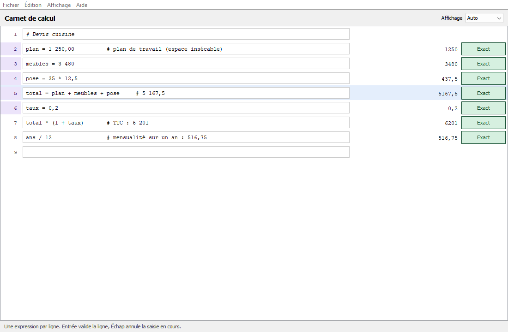
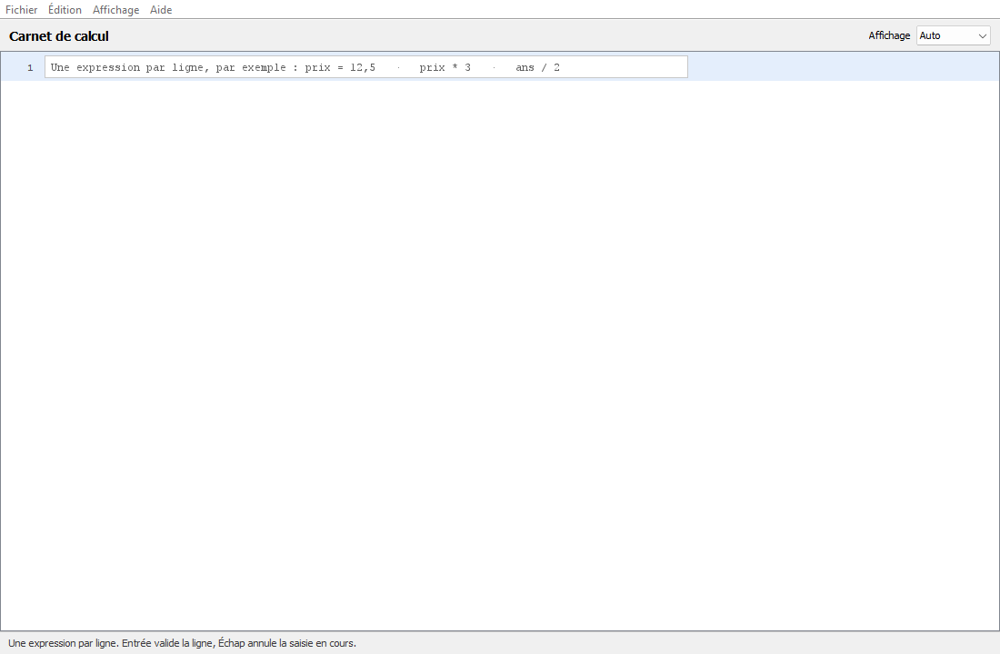

# Système de design de Calc : une feuille qui calcule

Ce document fixe l'apparence du bureau (Swing) et de la page web : principes, grille, typographie, couleurs et états de
chaque élément. Les valeurs ne sont pas recopiées ici : elles viennent toutes de
[tokens.properties](../../src/main/resources/calc/ui/design/tokens.properties), la source unique décrite par
l'[ADR 0016](../adr/0016-systeme-de-design-et-jetons.md). Ce document cite les jetons par leur nom ; le code les lit par le
même nom.

La [maquette statique](maquette.html) montre le carnet « Devis cuisine » du README en clair et en sombre, avec une ligne
approchée et une ligne en erreur. Elle ne charge que `web/site/tokens.css` et sa propre feuille, qui n'emploie que les
variables des jetons.

**Direction** : le cahier d'écolier à réglure Seyès. En clair, un papier à peine teinté de bleu, une encre bleu-noir, le
bleu de la réglure pour le focus et l'accent, le rouge du trait de marge pour les erreurs. En sombre, une ardoise bleu nuit
où les mêmes teintes sont éclaircies. La marge du cahier devient la marge de la ligne : c'est là que le calcul dit s'il est
exact.

## Principes

1. **Le document d'abord.** Le carnet occupe la fenêtre. Le titre « Carnet de calcul » disparaît, le titre de fenêtre
   nomme le document (`Devis.calc.json — Calc`, `Devis.calc.json (modifié) — Calc`, `Carnet sans titre — Calc`), et
   l'habillage se réduit à un contrôle segmenté et à une barre d'état. Les champs ne sont plus des cases encadrées : une
   ligne du carnet est une ligne de cahier.
2. **Deux voix typographiques.** Inter parle pour l'interface : menus, étiquettes, titres de section et commentaires de
   ligne entière. JetBrains Mono, à chiffres tabulaires, parle pour le calcul : ce que la personne tape et ce que le carnet
   répond. Les résultats se lisent comme un relevé, alignés à droite sur la virgule.
3. **L'exactitude comme langage visuel.** Un signe dans la marge dit tout : « = » pour une valeur exacte, « ≈ » pour une
   valeur approchée, « ! » pour une erreur. Le badge « Exact » répété sur chaque ligne disparaît. La couleur n'est jamais
   le seul porteur de sens : le signe est un caractère, et la description accessible de la ligne (`ResultDescription`) le
   dit en toutes lettres.
4. **Calme et focus.** Un seul accent ; les couleurs sont réservées au sens (exact, approché, source, erreur). Seules la
   ligne active et ses sources se distinguent ; le reste de la feuille se tait. Pas d'animation, pas d'ombre décorative.
5. **Clair, sombre ou système.** Les deux thèmes ont les mêmes rôles de couleur, et chaque paire de contraste atteint
   4,5:1 pour un texte et 3:1 pour un indicateur, dans les deux thèmes. Le menu Affichage > Thème propose « Clair »,
   « Sombre » et, sous Windows, « Système ».
6. **Découvrable.** Tout se trouve sans connaître les raccourcis : la palette de commandes (Ctrl+K), les trois exemples du
   carnet vide, l'aide de syntaxe dont les exemples s'insèrent, et la barre d'état qui rappelle ce que fait la touche
   suivante.

## Grille et espacements

Tout se place sur une grille de 4 px. Une hauteur de ligne, une marge intérieure ou un écart est toujours un multiple de
4 px ; la hauteur d'une ligne du carnet aussi, message d'erreur compris.

| Jeton | Valeur | Usage |
|---|---|---|
| `space.1` | 4 px | écart entre le signe et la marque de source dans la marge ; décalage du soulignement d'erreur |
| `space.2` | 8 px | marge intérieure d'un champ, écart entre l'étiquette d'affectation et le résultat |
| `space.3` | 12 px | marge intérieure du détail de la ligne active et de la barre d'état |
| `space.4` | 16 px | gouttière entre la marge et l'expression, et entre l'expression et le résultat |
| `space.6` | 24 px | écart au-dessus d'une ligne titre ; marge intérieure de la palette de commandes |
| `space.8` | 32 px | marges du carnet vide autour de ses trois exemples |

Les rayons suivent la même retenue : `radius.small` pour le contour de focus et les segments du sélecteur de mode,
`radius.medium` pour le détail de la ligne active et les boutons d'exemple, `radius.large` pour la palette de commandes.

**Colonnes d'une ligne**, de gauche à droite :

```text
| 12  =  ◆ | total = plan + meubles + pose              total     5 167,5   |
  marge      expression (lineField)                     nameLabel resultLabel
```

- la marge, de largeur fixe : numéro (`numberLabel`), signe (`exactnessSign`), marque de source (`sourceMark`), puis le
  filet vertical de la marge ;
- l'expression (`lineField`), qui prend toute la place restante ;
- l'étiquette d'affectation (`nameLabel`), collée à gauche du résultat ;
- le résultat (`resultLabel`), dans une colonne de largeur commune à toutes les lignes ;
- sous la ligne, le message d'erreur (`errorLabel`) et, pour la ligne active seulement, le détail (`lineDetail`).

## Typographie

Deux familles, aucune autre : `font.ui.family` (Inter) et `font.mono.family` (JetBrains Mono). Sur le bureau, elles sont
embarquées par leurs artefacts FlatLaf ; sur le web, la page les demande et retombe sur la police du système (`--font-ui`,
`--font-mono`).

| Jeton | Taille | Famille | Usage |
|---|---|---|---|
| `font.size.caption` | 12 px | Inter | numéro de ligne, étiquette d'affectation, barre d'état, intitulés du détail |
| `font.size.body` | 14 px | Inter ou JetBrains Mono | menus, boutons, commentaires de ligne entière ; expressions en JetBrains Mono |
| `font.size.result` | 16 px | JetBrains Mono | résultats et signe de la marge |
| `font.size.title` | 20 px | Inter, gras | ligne titre (`# Devis cuisine`) |

Règles :

- **Inter** pour l'interface, les titres de section et les commentaires de ligne entière.
- **JetBrains Mono à chiffres tabulaires** pour les expressions et les résultats : chaque chiffre a la même largeur, si
  bien que les colonnes de chiffres se lisent d'un coup d'œil.
- **Résultats alignés à droite sur la virgule** : la virgule décimale, ou la fin de la partie entière pour un entier, tombe
  à la même abscisse pour toutes les lignes. `437,5`, `5 167,5` et `6 201` partagent la même colonne des unités.
- Les milliers sont séparés par une espace fine insécable, comme dans le README (`5 167,5`).
- Une ligne titre garde son texte brut, `#` compris, dans le champ : seule la typographie change (Inter, `font.size.title`,
  gras).
- Une étiquette d'affectation est en Inter, `font.size.caption`, couleur `text.secondary`.

## Couleurs

Chaque couleur a un rôle, le même dans les deux thèmes ; seule la valeur change. Les valeurs sont dans
[tokens.properties](../../src/main/resources/calc/ui/design/tokens.properties), les propriétés CSS correspondantes
s'appellent `--color-<rôle avec tirets>` (`text.primary` devient `--color-text-primary`).

| Rôle | Usage |
|---|---|
| `surface.base` | fond de la feuille : le papier, ou l'ardoise en sombre |
| `surface.raised` | fond de l'en-tête, de la barre d'état, du détail de la ligne active et de la palette de commandes |
| `surface.hover` | fond d'une ligne sous le pointeur |
| `surface.active` | fond de la ligne active, celle qui a le focus |
| `border.subtle` | réglure entre les lignes, filet de la marge, contour du contrôle segmenté et des panneaux |
| `border.focus` | contour de focus clavier, visible sur tout élément qui reçoit le focus |
| `text.primary` | expressions, résultats, titres : l'encre |
| `text.secondary` | étiquettes d'affectation, numéro de la ligne active, barre d'état |
| `text.muted` | numéros de ligne, commentaires, filigranes, aperçu pendant la frappe |
| `accent` | segment choisi du sélecteur de mode, entrée choisie de la palette, liens |
| `exact.sign` | signe « = » d'une valeur exacte |
| `exact.surface` | fond d'une pastille « = » (réservé : le détail de la ligne active écrit ses phrases sans pastille) |
| `approximate.sign` | signe « ≈ » et résultat d'une valeur approchée |
| `approximate.surface` | fond d'une pastille « ≈ » (réservé : la mention « Valeur garantie entre L et U » du détail est écrite sans fond) |
| `source.mark` | marque « ◆ » des sources de la ligne active |
| `source.surface` | fond de la marge d'une ligne source de la ligne active |
| `error.text` | signe « ! » et message d'erreur |
| `error.surface` | fond d'une ligne en erreur |
| `error.underline` | soulignement de la partie fautive, et filet de marge d'une ligne en erreur |
| `selection.background` | fond du texte sélectionné |
| `selection.text` | texte sélectionné |

Les paires de contraste sont déclarées dans `tokens.properties` (`contrast.text.*` au moins 4,5:1, `contrast.ui.*` au
moins 3:1) et vérifiées dans les deux thèmes par `DesignTokensAcceptanceTest`. Une nouvelle combinaison de couleurs
commence par une nouvelle paire.

## États des éléments

### Ligne du carnet

| État | Marge | Expression | Résultat | Fond |
|---|---|---|---|---|
| **ligne normale** | numéro en `text.muted`, signe selon le résultat | JetBrains Mono, `text.primary` | aligné sur la virgule, `text.primary` | `surface.base` |
| **survol** | inchangée | inchangée | inchangé | `surface.hover` |
| **ligne active** | numéro en `text.secondary` | champ éditable, contour `border.focus` quand il a le focus | inchangé | `surface.active` ; le détail s'ouvre dessous |
| **ligne titre (#)** | numéro, pas de signe | Inter gras, `font.size.title`, `#` compris ; `space.6` au-dessus | aucun | `surface.base` |
| **commentaire de ligne entière** | numéro, pas de signe | Inter, `text.muted` | aucun | `surface.base` |
| **affectation** (`total = …`) | comme une ligne normale | texte complet, `total =` compris | précédé de l'étiquette `total` en Inter, `text.secondary` | `surface.base` |
| **résultat exact** | « = » en `exact.sign` | inchangée | `text.primary` | `surface.base` |
| **résultat approché** | « ≈ » en `approximate.sign` | inchangée | chiffres garantis seulement, suivis de « … », en `approximate.sign` | `surface.base` |
| **erreur** | « ! » en `error.text`, filet de marge en `error.underline` | partie fautive soulignée d'un trait ondulé `error.underline` | aucun | `error.surface` ; le message en `error.text` sous la ligne |
| **aperçu** | pas de signe tant que la ligne n'est pas validée | texte en cours de frappe | aperçu du résultat en `text.muted`, montré seulement s'il correspond au texte courant | `surface.active` |
| **source de la ligne active** | « ◆ » en `source.mark` sur fond `source.surface` | inchangée | inchangé | `surface.base` |
| **ligne vide ou calcul en attente** | numéro seul | filigrane en `text.muted` | aucun | `surface.base` |

Les composants d'une ligne ne sont jamais montrés ni cachés un par un : un état vide se rend en vidant le texte, ce qui
garde le carnet rapide sur 5000 lignes. L'ancien badge `ExactnessBadge` (« Exact », « ≈ Approché ») disparaît ; son sens
passe dans le signe de la marge et dans la description accessible.

### Erreur

Le message (`errorLabel`) se place **sous la ligne**, aligné sur le début de l'expression, en Inter `font.size.caption`,
couleur `error.text` ; par exemple, pour `total - remise` : Variable inconnue « remise ». La partie fautive de l'expression est soulignée en
`error.underline` ; la ligne prend le fond `error.surface`. La hauteur totale reste un multiple de 4 px.

### Détail de la ligne active

Un seul composant, `lineDetail`, se place sous la ligne active, à partir du début de l'expression, dans un cadre
`surface.raised` au filet `border.subtle`, coins `radius.medium`, marge intérieure `space.3`. Ses lignes sont exactement les
phrases de `calc.detail.LineDetailText`, les mêmes sur le bureau et sur le web, une par ligne et sans intitulé :

- le **développement** : « = » puis le membre de droite où chaque source exacte est remplacée par sa valeur, sur un niveau
  (`= 1250 + 3480 + 437,5`) ;
- le **résultat**, tel qu'il est affiché : « = » puis la valeur exacte (`= 5167,5`), ou la valeur approchée telle quelle,
  qui porte déjà « ≈ » ou se lit « |x| ≤ b » ;
- les **sources** : « Sources : lignes 2, 3 et 4 » ;
- l'usage : « Utilisée par 1 ligne », « Utilisée par N lignes » ou « Utilisée par aucune ligne » ;
- pour une valeur approchée : « Valeur garantie entre L et U », bornes arrondies vers l'extérieur.

Le développement et le résultat sont en JetBrains Mono `font.size.body`, les autres phrases en Inter `font.size.caption`,
toutes en `text.secondary` (paire de contraste `contrast.text.secondary-raised`). Un titre, un commentaire, une ligne vide
ou une ligne en erreur n'ont pas de détail : le composant est alors vide et ne prend aucune hauteur. Les sources de la
ligne active portent « ◆ » dans leur marge, ce qui relie le détail aux lignes qu'il cite.

### Contrôle segmenté des modes

`modeSelector`, nom accessible « Affichage » : quatre segments « Auto », « Décimal », « Fraction » et « Scientifique »
(`modeButtonAUTO`, `modeButtonDECIMAL`, `modeButtonFRACTION`, `modeButtonSCIENTIFIC`) dans un contour `border.subtle`. Le
segment choisi a le fond `accent` et le texte `selection.text` ; les autres sont en `text.secondary` sur `surface.raised`,
`surface.hover` au survol.

### Barre d'état

Sur `surface.raised`, en Inter `font.size.caption`, `text.secondary`, de gauche à droite :

- `statusLabel` : le message du moment, avec les mêmes priorités qu'aujourd'hui ;
- `saveStateLabel` : l'état d'enregistrement du document (« Enregistrement automatique », « Enregistré », « Modifié »,
  « Lecture seule » ; ce dernier en `error.text`, le texte porte l'information, la couleur l'accompagne) ;
- `lineCountLabel` : « 11 lignes » ;
- `summaryLabel` : « N exactes, M approchées, K en erreur ».

Pendant un calcul, on lit « Calcul en cours : n / N lignes — Échap pour interrompre ».

### Palette de commandes

`commandPalette` est une couche posée sur la fenêtre, pas un dialogue modal : champ de recherche
(`commandPaletteSearch`) et liste (`commandPaletteList`) sur `surface.raised`, `radius.large`, contour `border.subtle`.
Le libellé d'une entrée est en `text.primary` et son raccourci, aligné à droite, en `text.secondary` (paires
`contrast.text.primary-raised` et `contrast.text.secondary-raised`) ; une entrée indisponible est grisée. L'entrée choisie a
le fond `accent` et le texte `selection.text` (paire `contrast.text.palette-selected`). Elle s'ouvre par Ctrl+K (Cmd+K sous macOS) et par Aide >
« Palette de commandes… ». Les libellés suivent une seule règle : « Mode Décimal », « Thème : Sombre », et le texte exact
de l'élément de menu pour tout le reste.

### Carnet vide

Un carnet vide montre, sous la première ligne, trois exemples cliquables en Inter (`exampleButtonDEVIS`,
`exampleButtonRACINE`, `exampleButtonREFERENCES`) : un devis avec des variables, une racine qui donne une valeur approchée,
et des références `$n` entre lignes. Un clic remplit le carnet avec l'exemple.

### Focus visible

Le **focus clavier** est toujours visible : un contour de 2 px en `border.focus`, `radius.small`, autour du champ d'une
ligne, d'un segment, d'un bouton d'exemple ou d'une entrée de palette. `contrast.ui.focus` garantit au moins 3:1 sur
`surface.base` et sur `surface.active`.

## Interface actuelle

Captures du bureau avant la refonte, peintes hors écran par le générateur de captures sur le même carnet de démonstration :





Défauts relevés :

- **Le document n'est pas d'abord** : le titre « Carnet de calcul » et la liste déroulante « Affichage » prennent une bande
  entière ; chaque ligne est une case encadrée, comme un formulaire.
- **Une seule voix** : expressions, titre et commentaires partagent la même police à chasse fixe du système ; la ligne
  `# Devis cuisine` ne se distingue que par l'italique.
- **Les résultats ne se lisent pas comme un relevé** : `1250`, `437,5` et `5167,5` sont alignés sur leur dernier caractère,
  pas sur la virgule, et perdent le séparateur des milliers que la personne a tapé.
- **L'exactitude est bruyante** : le badge vert « Exact » se répète sur chaque ligne et prend autant de place que le
  résultat ; une valeur approchée n'a pas de signe dans la marge.
- **Les liens entre lignes sont muets** : la marge se teinte de violet sans légende, et rien ne dit d'où vient `total` ni
  qui l'utilise. Les étiquettes d'affectation n'existent pas.
- **Rien ne se découvre** : le carnet vide n'offre qu'un filigrane ; la barre d'état répète la même consigne ; les
  commandes ne se trouvent que dans les menus.
- **Pas de thème sombre**, et l'apparence change selon le système.
