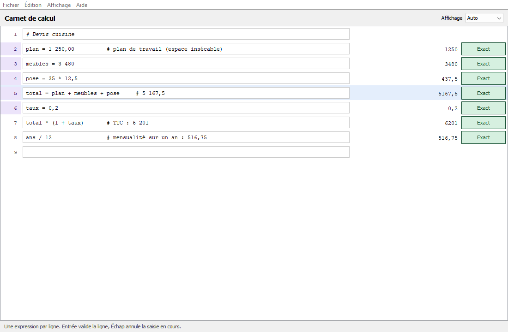
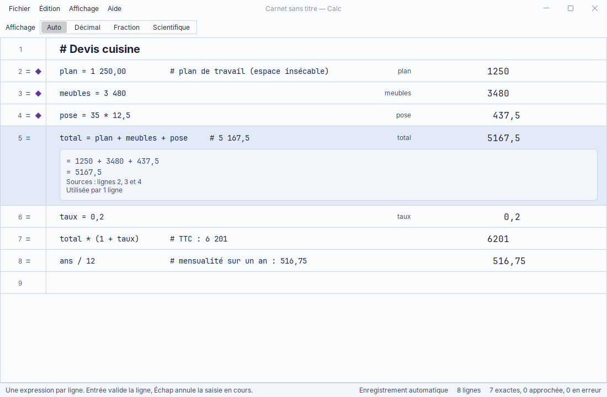
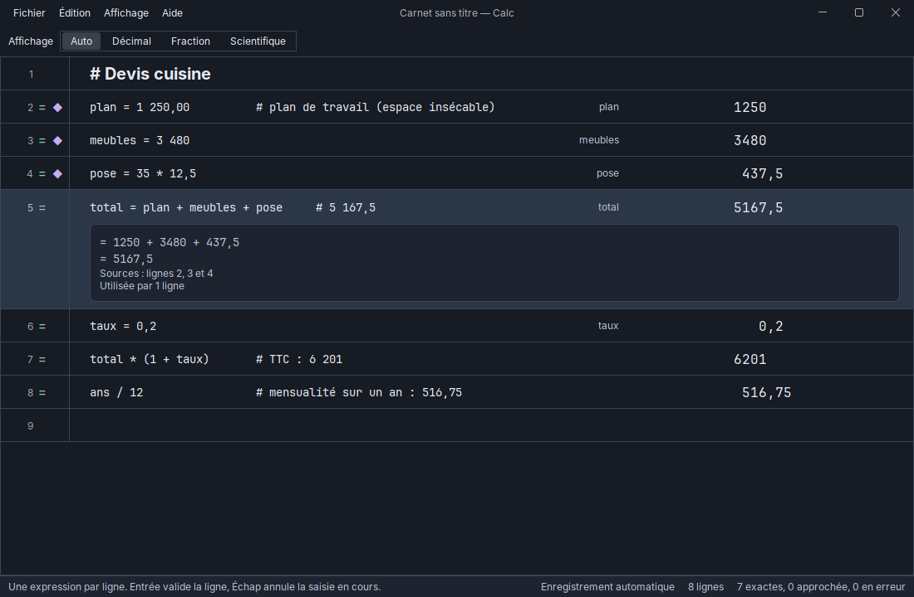
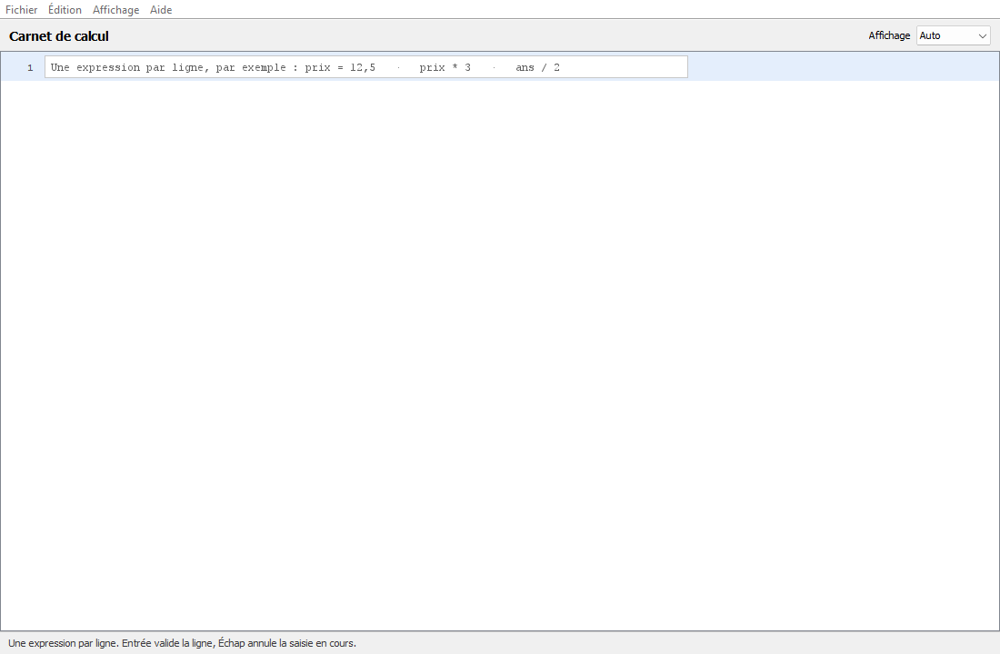
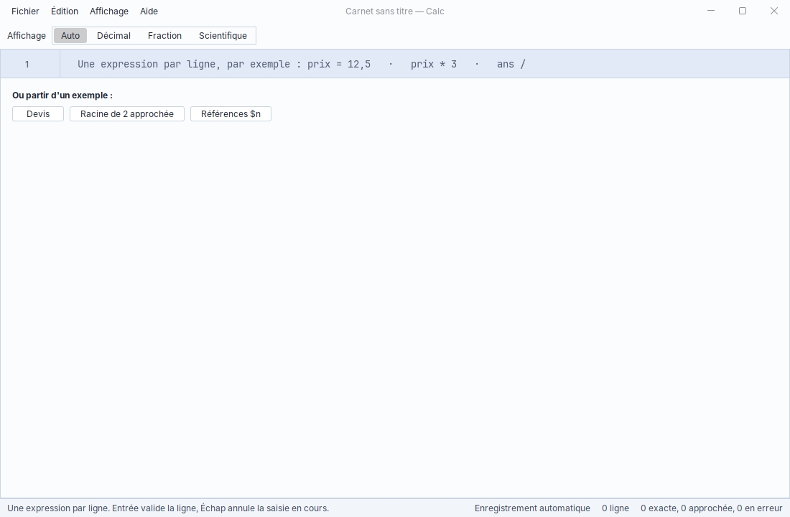
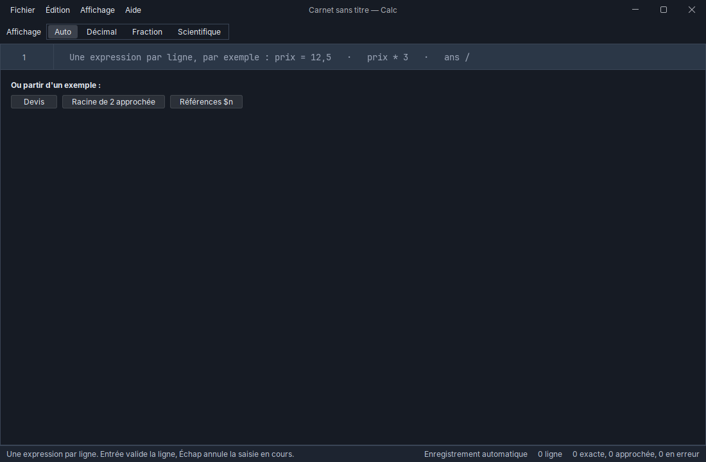

# Avant et après la refonte

La refonte de Calc, « une feuille qui calcule », est décrite dans [DESIGN.md](DESIGN.md) et fixée par les ADR
[0016](../adr/0016-systeme-de-design-et-jetons.md) (jetons de design) et [0017](../adr/0017-flatlaf-et-polices-embarquees.md)
(FlatLaf et polices embarquées). Cette page met côte à côte la fenêtre d'avant et celle d'après, puis donne ce que la
refonte coûte et garantit : taille de l'archive, contrastes, temps de réponse.

## Captures

Les captures d'avant ont été prises avec l'apparence du système, avant la refonte. Celles d'après sont peintes par
`gradlew screenshots "-PscreenshotDir=docs/images" -PscreenshotTheme=tous`, hors écran, en 1100 × 720 : la fenêtre est
construite comme au lancement de l'application, avec les polices embarquées et le thème demandé.

**Devis cuisine**, l'exemple du README, la ligne `total` active :

| Avant | Après, thème clair | Après, thème sombre |
|---|---|---|
|  |  |  |

Ce qui change : le titre `# Devis cuisine` est en gras et plus grand ; chaque affectation porte son nom en petit à côté
du résultat ; les résultats sont en JetBrains Mono, alignés sur la virgule ; la marge donne le numéro, le signe « = » d'une
valeur exacte et la marque « ◆ » des sources de la ligne active (lignes 2, 3 et 4) ; sous la ligne `total`, le détail
donne le développement `1250 + 3480 + 437,5`, le résultat, ses sources et « Utilisée par 1 ligne » ; la barre d'état
compte les lignes et résume « 7 exactes, 0 approchée, 0 en erreur ».

**Carnet vide** :

| Avant | Après, thème clair | Après, thème sombre |
|---|---|---|
|  |  |  |

Le carnet vide propose trois exemples à insérer d'un clic ou au clavier : **Devis**, **Racine de 2 approchée** et
**Références $n**.

Deux exécutions de `gradlew screenshots` sur le même poste donnent les mêmes fichiers, octet pour octet (SHA-256 égaux).
Sur un autre système, le rendu de Java2D et de FlatLaf peut différer : les tests ne comparent jamais une image versionnée à
un rendu frais.

## Taille de l'archive

FlatLaf et les deux polices sont les seules dépendances d'exécution ajoutées. Mesurée sur l'archive Windows
`Calc-1.0.0-windows-x64.zip` (ADR 0017), la hausse est de 3 511 732 octets, soit 9,8 % : 35 986 226 octets avant,
39 497 958 octets après. Elle vient surtout des polices.

## Contrastes

Chaque paire de contraste déclarée dans
[tokens.properties](../../src/main/resources/calc/ui/design/tokens.properties) est mesurée dans les deux thèmes par
`DesignTokensAcceptanceTest` : au moins 4,5:1 pour un texte (`contrast.text.*`), au moins 3:1 pour un indicateur qui n'est
pas du texte (`contrast.ui.*`). Toutes passent.

| Paire | Rôles | Clair | Sombre | Minimum |
|---|---|---|---|---|
| `contrast.text.accent` | `accent` sur `surface.base` | 6,29:1 | 8,00:1 | 4,5:1 |
| `contrast.text.approximate` | `approximate.sign` sur `surface.base` | 6,98:1 | 9,32:1 | 4,5:1 |
| `contrast.text.approximate-active` | `approximate.sign` sur `surface.active` | 5,90:1 | 6,51:1 | 4,5:1 |
| `contrast.text.approximate-badge` | `approximate.sign` sur `approximate.surface` | 6,12:1 | 7,31:1 | 4,5:1 |
| `contrast.text.approximate-hover` | `approximate.sign` sur `surface.hover` | 6,25:1 | 7,39:1 | 4,5:1 |
| `contrast.text.error` | `error.text` sur `surface.base` | 6,42:1 | 8,26:1 | 4,5:1 |
| `contrast.text.error-active` | `error.text` sur `surface.active` | 5,43:1 | 5,77:1 | 4,5:1 |
| `contrast.text.error-hover` | `error.text` sur `surface.hover` | 5,75:1 | 6,55:1 | 4,5:1 |
| `contrast.text.error-raised` | `error.text` sur `surface.raised` | 6,03:1 | 7,46:1 | 4,5:1 |
| `contrast.text.error-surface` | `error.text` sur `error.surface` | 5,85:1 | 7,18:1 | 4,5:1 |
| `contrast.text.exact` | `exact.sign` sur `surface.base` | 6,26:1 | 9,23:1 | 4,5:1 |
| `contrast.text.exact-active` | `exact.sign` sur `surface.active` | 5,29:1 | 6,45:1 | 4,5:1 |
| `contrast.text.exact-badge` | `exact.sign` sur `exact.surface` | 5,51:1 | 7,39:1 | 4,5:1 |
| `contrast.text.exact-hover` | `exact.sign` sur `surface.hover` | 5,60:1 | 7,32:1 | 4,5:1 |
| `contrast.text.exact-raised` | `exact.sign` sur `surface.raised` | 5,88:1 | 8,34:1 | 4,5:1 |
| `contrast.text.muted` | `text.muted` sur `surface.base` | 6,16:1 | 7,04:1 | 4,5:1 |
| `contrast.text.muted-active` | `text.muted` sur `surface.active` | 5,21:1 | 4,92:1 | 4,5:1 |
| `contrast.text.muted-error` | `text.muted` sur `error.surface` | 5,61:1 | 6,12:1 | 4,5:1 |
| `contrast.text.muted-hover` | `text.muted` sur `surface.hover` | 5,52:1 | 5,58:1 | 4,5:1 |
| `contrast.text.muted-raised` | `text.muted` sur `surface.raised` | 5,79:1 | 6,35:1 | 4,5:1 |
| `contrast.text.palette-selected` | `selection.text` sur `accent` | 6,46:1 | 8,00:1 | 4,5:1 |
| `contrast.text.primary` | `text.primary` sur `surface.base` | 15,49:1 | 14,32:1 | 4,5:1 |
| `contrast.text.primary-active` | `text.primary` sur `surface.active` | 13,10:1 | 10,01:1 | 4,5:1 |
| `contrast.text.primary-error` | `text.primary` sur `error.surface` | 14,11:1 | 12,44:1 | 4,5:1 |
| `contrast.text.primary-hover` | `text.primary` sur `surface.hover` | 13,87:1 | 11,35:1 | 4,5:1 |
| `contrast.text.primary-raised` | `text.primary` sur `surface.raised` | 14,55:1 | 12,93:1 | 4,5:1 |
| `contrast.text.secondary` | `text.secondary` sur `surface.base` | 8,70:1 | 9,73:1 | 4,5:1 |
| `contrast.text.secondary-active` | `text.secondary` sur `surface.active` | 7,35:1 | 6,80:1 | 4,5:1 |
| `contrast.text.secondary-error` | `text.secondary` sur `error.surface` | 7,92:1 | 8,46:1 | 4,5:1 |
| `contrast.text.secondary-hover` | `text.secondary` sur `surface.hover` | 7,79:1 | 7,71:1 | 4,5:1 |
| `contrast.text.secondary-raised` | `text.secondary` sur `surface.raised` | 8,17:1 | 8,78:1 | 4,5:1 |
| `contrast.text.selection` | `selection.text` sur `selection.background` | 6,46:1 | 8,00:1 | 4,5:1 |
| `contrast.text.source` | `source.mark` sur `surface.base` | 8,13:1 | 8,74:1 | 4,5:1 |
| `contrast.text.source-cell` | `source.mark` sur `source.surface` | 6,85:1 | 7,35:1 | 4,5:1 |
| `contrast.ui.accent` | `accent` sur `surface.base` | 6,29:1 | 8,00:1 | 3,0:1 |
| `contrast.ui.error-underline` | `error.underline` sur `surface.base` | 5,01:1 | 6,46:1 | 3,0:1 |
| `contrast.ui.error-underline-active` | `error.underline` sur `surface.active` | 4,24:1 | 4,51:1 | 3,0:1 |
| `contrast.ui.error-underline-hover` | `error.underline` sur `surface.hover` | 4,48:1 | 5,12:1 | 3,0:1 |
| `contrast.ui.error-underline-surface` | `error.underline` sur `error.surface` | 4,56:1 | 5,61:1 | 3,0:1 |
| `contrast.ui.focus` | `border.focus` sur `surface.base` | 6,29:1 | 8,00:1 | 3,0:1 |
| `contrast.ui.focus-active` | `border.focus` sur `surface.active` | 5,32:1 | 5,59:1 | 3,0:1 |

## Temps de réponse sur 5000 lignes

Les budgets de temps n'ont pas changé avec la refonte. Durées relevées sur le poste de développement (Windows 11), sur
trois passes de chaque test (`--rerun`) ; un budget est multiplié par le facteur de `TimingBudget` sur une
machine plus lente (voir [TESTS.md](../TESTS.md)).

| Test | Mesure | Durées relevées | Budget |
|---|---|---|---|
| `NotebookFrameResponsivenessTest` | Entrée sur la ligne 1 d'un carnet de 5000 lignes, mise en page et peinture comprises (médiane de 15 essais) | 238,9 à 246,1 ms | 1000 ms |
| `NotebookFrameResponsivenessTest` | La même chose sur 500 lignes | 41,7 à 45,6 ms | 100 ms |
| `BackgroundRecalculationAcceptanceTest` | Retour du fil de l'interface après l'ouverture de 5000 lignes lourdes (meilleur de trois) | 30,9 à 35,6 ms | 300 ms |
